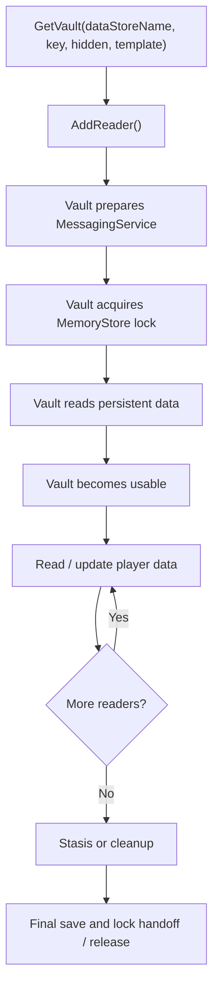

<div align="center">

# ◈ DataVault

### A session-aware data vault for Roblox experiences.

**One player. One active vault. Multiple servers. Zero intentional lock races.**

[](#)
[](#)
[](#)
[](#)

<br/>

**DataVault coordinates access to player data across live game servers using MemoryStore-backed locks and MessagingService notifications.**

<br/>

[Getting Started](#-getting-started) ·
[Usage](#-the-usual-workflow) ·
[API](#-api-reference) ·
[How It Works](#-under-the-hood) ·
[Best Practices](#-tips-tricks--footguns)

</div>

---

> [!IMPORTANT]
> DataVault is a coordination and persistence layer, not a replacement for good data modelling. Keep templates serializable, use the update API for mutations, and handle the possibility that Roblox services are temporarily unavailable.

## ✨ What is DataVault?

Imagine a player leaves Server A and joins Server B before Server A has fully finished handling their data.

Now both servers want to load, modify, and save the same vault.

That is a data collision waiting to happen.

**DataVault is designed to coordinate that handoff.** It uses:

| Roblox service | What DataVault uses it for |
|---|---|
| **DataStoreService** | Persistent player data |
| **MemoryStoreService** | Shared, expiring ownership locks |
| **MessagingService** | Notifications between vault sessions |
| **Server-local state** | Readers, lifecycle state, save/renew loops |

The goal is straightforward: coordinate which server may work with a player's vault, keep the lock alive while the vault is active, and hand ownership over when the vault is released.

## ⚡ At a glance

- **Strict typed:** every variable and method is strict, so making mistakes is harder and IntelliSense works like a charm.
- **Shared vault per key:** repeated requests for the same DataStore/key in one server return the existing vault.
- **Reader-based lifetime:** each consumer gets its own release function.
- **Lock coordination:** MemoryStore is used to coordinate ownership across servers.
- **Faster handoffs:** MessagingService notifies the current owner about an incoming acquisition.
- **Automatic persistence:** dirty data is saved by the vault's save loop.
- **Lock renewal:** active vaults periodically renew their MemoryStore lock.
- **Stasis:** when the final reader releases, the vault can remain around briefly before cleanup.
- **Shutdown handling:** active readers are released when the server begins shutting down.

---

## 🚀 Getting Started

### 1. Install the module

Place the DataVault module and its required child modules in your Roblox project, preserving the expected hierarchy.

The main module expects:

```text
DataVault
├── VaultsHolder
├── Types
├── Utils
├── Constants
... (Signal, State and Thread are required from the parent, you can find those from my github)
```

The exact hierarchy matters because the module uses `WaitForChild()` and `require()` with those locations. You can freely modify the locations but make sure to modify the require calls

### 2. Enable the required services

In your experience's Roblox settings, enable **Studio Access to API Services** when testing DataStore, MemoryStore, and MessagingService functionality in Studio.

For production, make sure the experience is published and the relevant services are available to the experience.

### 3. Require DataVault

The module exposes `GetVault` and a few service-health states:

```lua
local DataVault = require(path.to.DataVault)
```

### 4. Define a serializable template

Your template is the default shape of a player's public data.

```lua
local PlayerTemplate = {
    Coins = 0,
    Level = 1,

    Inventory = {
        "Wooden Sword",
    },

    Settings = {
        Music = true,
        SFX = true,
    },
}
```

> [!WARNING]
> Keep templates Roblox-serializable. DataVault does not guarantee correct behaviour for unsupported or non-serializable values. Use the same/upgraded template shape for every simultaneous open of the same vault.

---

## 🧭 The usual workflow

The basic lifecycle is:



### Open a vault

```lua
local vault = DataVault.GetVault(
    "PlayerData_v1",  -- DataStore name
    tostring(player.UserId), -- Unique string key
    false,            -- Visible vault
    PlayerTemplate    -- Default data
)

local release = vault:AddReader()
```

`AddReader()` starts or resumes the vault lifecycle and returns a function that releases that reader.

**Important:** opening a vault is asynchronous. Do not read or mutate player data until the vault reports that it is usable.

### Wait until the vault is usable

The vault exposes a state object through `vault.Usable`.

```lua
while not vault.Usable.Current do
    vault.Usable.ChangeSignal:Wait()
end

local data = vault:GetPublicData()
print("Coins:", data.Coins)
```

If your project wraps vault opening in a higher-level loader, put this wait there rather than repeating it throughout gameplay scripts.

### Update data

Use `UpdateData()` for changes that should be tracked by DataVault.

```lua
vault:UpdateData({"Coins"}, 250)
vault:UpdateData({"Level"}, 2)
vault:UpdateData({"Settings", "Music"}, false)
```

Nested paths are arrays of keys. The final key receives the new value.

### Release the reader

When the player leaves, release the reader:

```lua
local function onPlayerRemoving(player)
    local release = activeReaders[player]

    if release then
        release()
        activeReaders[player] = nil
    end
end
```

Keep the release function associated with the reader that created it. Calling the same release function more than once is safe by design: a reader is removed only once.

---

## 🧩 Complete example

A small server-side example tying the workflow together:

```lua
local Players = game:GetService("Players")

local DataVault = require(path.to.DataVault)

local PlayerTemplate = {
    Coins = 0,
    Level = 1,
    Inventory = {},
}

local active = {}

local function loadPlayer(player)
    local vault = DataVault.GetVault(
        "PlayerData_v1",
        tostring(player.UserId),
        false,
        PlayerTemplate
    )

    local release = vault:AddReader()
    active[player] = {
        Vault = vault,
        Release = release,
    }

    -- Wait for the asynchronous open to finish.
    while not vault.Usable.Current do
        vault.Usable.ChangeSignal:Wait()
    end

    -- The player may have left while the vault was opening.
    if player.Parent ~= Players then
        return
    end

    local data = vault:GetPublicData()

    print(player.Name, "loaded with", data.Coins, "coins")
end

local function unloadPlayer(player)
    local session = active[player]
    if not session then
        return
    end

    -- Release this consumer's reader.
    session.Release()
    active[player] = nil
end

Players.PlayerAdded:Connect(loadPlayer)
Players.PlayerRemoving:Connect(unloadPlayer)

-- Also handle players already present if this script starts late.
for _, player in Players:GetPlayers() do
    task.spawn(loadPlayer, player)
end
```

> [!NOTE]
> This is an integration example, not a complete production player loader. Your game should also handle a vault that never becomes usable, a player leaving during a service retry, and any application-specific loading timeout or failure policy. For more details, go through the full Documentation.

---

## 📚 API reference

### `DataVault.GetVault(dataStoreName, vaultName, hidden, template)`

Gets the server-local vault for the specified DataStore and key, or creates it if one does not already exist. This method is non-blocking.

| Parameter | Type | Description |
|---|---|---|
| `dataStoreName` | `string` | Name used to obtain the DataStore and associated lock map |
| `vaultName` | `string` | Unique key for this player's data |
| `hidden` | `boolean` | Whether the vault is opened in hidden mode |
| `template` | `table` | Default public data structure |

If the vault already exists in the current server, the existing vault is returned. Requesting it as visible upgrades an existing hidden vault to visible.

**Template rule:** two simultaneous opens of the same vault must use the same\upgraded template.

### `vault:AddReader()`

Adds a reader, starts/resumes the vault lifecycle, and returns a unique release function. This method is non-blocking.

```lua
local release = vault:AddReader()

-- Later:
release()
```

Every caller that adds a reader must release that reader when finished. The vault can enter stasis or cleanup when its final reader is released.

### `vault:GetPublicData()`

Returns the vault's public data table.

```lua
local data = vault:GetPublicData()
print(data.Coins)
```

Use only while the vault is usable and there exist one reader at least.

### `vault:GetActivityData()`

Returns the vault's activity data table.

```lua
local activity = vault:GetActivityData()
print(activity.LastLogIn)
```

Use only while the vault is usable and there exist one reader at least.

### `vault:UpdateData(keys, value)`

Updates a value at a nested key path and notifies `DataUpdatedSignal`. This method is non-blocking.

```lua
vault:UpdateData({"Coins"}, 500)
vault:UpdateData({"Profile", "Wins"}, 12)
```

### `vault.Usable`

A state object indicating whether the vault is currently usable.

```lua
if vault.Usable.Current then
    print("Vault is ready")
else
    local currentState = vault.Usable.ChangeSignal:Wait()
end
```

Its `ChangeSignal` can be used to wait for state changes.

### `vault.DataUpdatedSignal`

Signal fired when `UpdateData()` changes a value.

```lua
local connection = vault.DataUpdatedSignal:Connect(function(keys, value)
    print("Changed:", table.concat(keys, "."), value)
end)

-- Disconnect when no longer needed.
connection:Disconnect()
```

> [!WARNING]
> The signal is for changes made through `UpdateData()`. Directly mutating the table returned by a getter bypasses this notification path and also does not guarantee data save, so it must be avoided.

### `vault.Name`, `vault.Session`, `vault.Server`, `vault.Hidden`, `vault.Locals`

Useful vault metadata and server-local storage:

```lua
print(vault.Name)
print(vault.Session)
print(vault.Server)
print(vault.Hidden)

vault.Locals.MySystem = {}
```

`Locals` is server-local and is not part of the persisted public player data. Developer can keep any data to remember for each vault. But the data will be lost after vault is cleaned up.

### Module-level health states

```lua
local memoryStoreWorking = DataVault.MemoryStoreWorking
local dataStoreWorking = DataVault.DataStoreWorking
local shuttingDown = DataVault.ServerShuttingDown
```

These are state objects, not plain booleans. Read their `.Current` values:

```lua
if not DataVault.MemoryStoreWorking.Current then
    warn("The latest MemoryStore operation failed")
end

if not DataVault.DataStoreWorking.Current then
    warn("The latest DataStore operation failed")
end
```

These indicate the result of the latest tracked operation; they are not a guarantee that the service is globally healthy or unhealthy rather can be used for failure percentages.

---

## 🧠 Under the hood

### The lock is the authority

MemoryStore holds the shared lock record. A vault must acquire that lock before it becomes usable.

While active, the vault renews its lock so another server does not simply take over an active session.

### MessagingService speeds up handoffs

When another server wants a vault that is already owned, it can notify the current owner.

The current owner can then save and release or hand off the lock. The waiting server can retry acquisition rather than relying only on periodic polling.

MessagingService is a notification mechanism. It is not treated as the source of truth for lock ownership.

### Readers control the local lifetime

A vault can have multiple readers in one server.

```text
Reader A ─┐
Reader B ─┼──> One shared vault
Reader C ─┘
```

Releasing one reader does not close the vault while other readers remain.

When the last reader releases, the vault enters its idle lifecycle:

```text
ACTIVE
  │
  ▼
STASIS
  │
  ├── A new reader arrives ──> REVIVE
  │
  └── Idle period expires ───> CLEANUP
```

This avoids repeatedly tearing down and rebuilding a vault assuming the player will return after leaving the server.

---

## 🎯 Tips, tricks & footguns

### ✅ Do this

- **Use UserId as the key.** `tostring(player.UserId)` is a straightforward, stable key for player vault. Developers can use an optional BaseConverter module from my GitHub to convert UserId number to a shorter string.
- **Version your DataStore names.** Change in template is automatically reconciled the next time the vault is opened. For a breaking schema change, consider moving from `PlayerData_v1` to `PlayerData_v2` with an intentional migration plan.
- **Use `UpdateData()` for mutations.** It marks the data dirty and fires the update signal.
- **Keep the release function.** Store it alongside the player/session that acquired the reader. There can be multiple readers, so a good idea is keeping a reader as soon as player joins and releasing it only when player leaves, and other readers are created and released as they are used.
- **Wait for usability.** `GetVault()` returning a vault does not mean its data has finished loading.
- **Keep data serializable.** Store values supported by Roblox DataStores.

### ❌ Avoid this

#### Don't mutate getter results directly

```lua
-- BAD: bypasses dirty tracking and DataUpdatedSignal
vault:GetPublicData().Coins += 100
```

```lua
-- GOOD
local data = vault:GetPublicData()
vault:UpdateData({"Coins"}, data.Coins + 100)
```

#### Don't forget to release readers

```lua
-- BAD: reader remains active
local release = vault:AddReader()
-- ... work happens ...
-- release is never called
```

#### Don't assume a service call always succeeds

Roblox services can throttle, fail, or become temporarily unavailable. Build your player-loading and gameplay flows so they can handle delayed availability.

### Nested updates: a small but important detail

```lua
vault:UpdateData({"Stats", "Combat", "Wins"}, 15)
```

The path is traversed from left to right. Intermediate values must be tables (or absent and creatable by the implementation). Avoid paths that collide with existing scalar values.

---

## 🧪 Testing checklist

Before shipping a game that depends on DataVault, test more than the happy path.

- [ ] Two servers attempt to open the same player key at nearly the same time.
- [ ] A player rapidly leaves and rejoins.
- [ ] Several systems add readers to the same vault.
- [ ] Readers release in different orders.
- [ ] A player leaves while the vault is still opening.
- [ ] MessagingService notifications are delayed or unavailable.
- [ ] MemoryStore operations fail during acquisition or renewal.
- [ ] DataStore reads and writes fail temporarily.
- [ ] The server shuts down with active readers.
- [ ] A vault is revived during its stasis period.
- [ ] Existing saved data is missing newly introduced template fields.
- [ ] A saved record has missing or malformed activity/public sections.

Use separate published test servers for genuine cross-server testing. A single Studio session is not a substitute for testing real service coordination.

---

## ⚙️ Configuration

DataVault's timing and lock behaviour are defined in its `Constants` module.

Review the constants as a group rather than changing one delay in isolation. In particular, understand the relationship between:

- Lock expiry.
- Lock renewal interval.
- Lock stale detection.
- Messaging expected delay.
- Data save interval.

The timing values must leave enough room for service latency, retries, and scheduling delays.

> [!CAUTION]
> Do not shorten lock expiry or stale-detection intervals just to make handoffs appear faster. Aggressive values can increase contention and make transient delays look like dead servers.

---

## 🛡️ Reliability notes

DataVault coordinates sessions, but no distributed system can make Roblox service failures disappear.

A robust game should still:

1. Avoid allowing gameplay systems to modify data before the vault is usable.
2. Stop or restrict data-dependent gameplay when ownership is uncertain.
3. Handle failed loads and prolonged service outages.
4. Avoid direct writes to the underlying DataStore for keys managed by DataVault.
5. Keep backups and test schema migrations before deploying them.

If you build trading, gifting, or other multi-player transactions, keep the relevant readers alive on both the vaults for the entire transaction and design the transaction itself to be recoverable. 

---

## ❓ FAQ

<details>
<summary><strong>Does calling GetVault twice create two vaults?</strong></summary>

Not when the same DataStore name and vault key resolve to an existing vault in the same server. The existing vault is returned.
</details>

<details>
<summary><strong>Why do I need AddReader()?</strong></summary>

Readers tell DataVault that a system is actively using the vault. Each reader receives its own release function, and the vault can idle only after the final reader is released.
</details>

<details>
<summary><strong>Can I use GetPublicData() to edit data?</strong></summary>

You can access the returned table, but direct mutation bypasses DataVault's dirty tracking and update signal. Use `UpdateData()` for changes.
</details>

<details>
<summary><strong>Can I use a different template for the same key?</strong></summary>

No. Simultaneous opens of the same vault should use the same/upgraded template. For schema changes, use a deliberate migration strategy.
</details>

---

## 📦 Version

**DataVault v1.0.0**

The implementation is designed around Roblox DataStoreService, MemoryStoreService, and MessagingService. Check the repository's release notes and changelog for changes between versions.

## 🤝 Contributing

Found a reproducible issue? Please include:

- The DataVault version.
- The relevant `Constants` values (remove anything sensitive).
- Whether it happened in Studio or published servers.
- The sequence of server/player actions.
- Relevant warnings and errors.
- Whether the issue reproduces consistently.

A clear reproduction is worth more than a screenshot of an error.

---

<div align="center">

### Built for the moments when players switch servers faster than your data can blink.

**DataVault — keep the session coordinated.**

</div>
