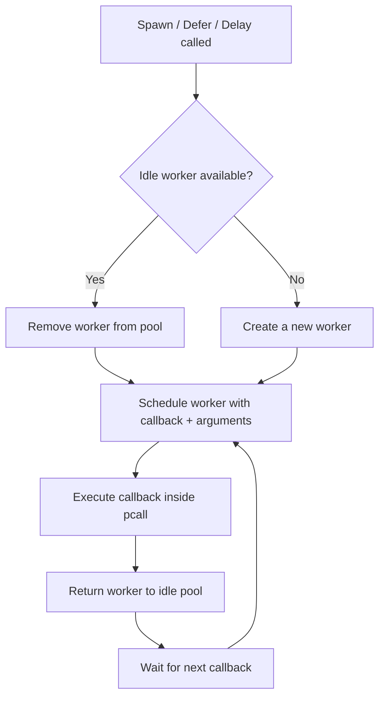

<div align="center">

# ⚡ Thread

### A lightweight coroutine pool for Roblox Luau.

**Reuse threads. Skip unnecessary creation. Keep your async code moving.**

[](#)
[](#)
[](#)

**Thread reuses idle worker coroutines behind a familiar `Spawn`, `Defer`, and `Delay` API.**

[Getting Started](#-getting-started) · [Usage](#-usage) · [API](#-api-reference) · [Internals](#-how-it-works) · [Tips](#-tips-tricks--footguns)

</div>

---

## 🧠 What is Thread?

Roblox's `task` library makes scheduling work straightforward:

```lua
task.spawn(doSomething)
task.defer(doSomething)
task.delay(2, doSomething)
```

Thread keeps that familiar style, but adds a pool of reusable worker coroutines.

Instead of creating a fresh worker for every call, Thread can take an idle coroutine from its pool, run your function, and return that coroutine to the pool when the function finishes.

**The idea:** create a worker when the pool is empty; reuse it when one is available.

> [!NOTE]
> Thread is a small scheduling utility, not a replacement for Roblox's task scheduler. It schedules work using `task.spawn`, `task.defer`, and `task.delay`.

## ✨ Features

- **Coroutine reuse** — completed workers return to an idle pool.
- **Familiar API** — `Spawn`, `Defer`, and `Delay`.
- **Generic arguments** — function parameters are forwarded to the scheduled callback.
- **Error isolation** — callbacks run inside `pcall`, so a callback error does not terminate the worker loop.
- **Lazy growth** — new workers are created only when the idle pool is empty.
- **Automatic return** — workers are placed back in the pool after callback execution.

---

## 🚀 Getting Started

### 1. Install

Place the `Thread` ModuleScript somewhere accessible to the scripts that need it.

```text
Packages
└── Thread
```

### 2. Require

```lua
local Thread = require(
    game:GetService("ReplicatedStorage")
        .Packages
        .Thread
)
```

### 3. Schedule work

```lua
Thread.Spawn(function()
    print("Runs as soon as the scheduler can resume it")
end)

Thread.Defer(function()
    print("Runs after the current resumption cycle")
end)

Thread.Delay(3, function()
    print("Runs after approximately 3 seconds")
end)
```

---

## 🎮 Usage

### Spawn — run as soon as possible

```lua
Thread.Spawn(function()
    print("Hello from a pooled worker!")
end)

local function awardCoins(player, amount)
    print("Awarding", amount, "coins to", player.Name)
end

Thread.Spawn(awardCoins, player, 100)
```

Use `Spawn` for work that should begin immediately through the task scheduler.

### Defer — run after the current resumption cycle

```lua
Thread.Defer(function()
    print("Deferred work")
end)

local function refreshLeaderboard(boardName, force)
    print("Refreshing", boardName, "force:", force)
end

Thread.Defer(refreshLeaderboard, "GlobalWins", true)
```

### Delay — run after a duration

```lua
Thread.Delay(5, function()
    print("Five seconds have passed")
end)

local function removeTemporaryEffect(character, effectName)
    print("Removing", effectName, "from", character.Name)
end

Thread.Delay(10, removeTemporaryEffect, character, "Shield")
```

The delay follows Roblox task-scheduler timing; it is not a precision timer.

---

## 🧩 A practical example

```lua
local Thread = require(path.to.Thread)

local function saveCheckpoint(player, checkpointId)
    print("Saving checkpoint", checkpointId, "for", player.Name)
    -- Your checkpoint persistence logic
end

local function updateQuest(player, questName)
    print("Updating quest:", questName, "for", player.Name)
    -- Your quest logic
end

local function announceRespawn(player)
    print(player.Name, "has respawned!")
end

Thread.Spawn(saveCheckpoint, player, 12)
Thread.Defer(updateQuest, player, "First Victory")
Thread.Delay(2, announceRespawn, player)
```

Each call obtains a worker from the pool, or creates one if no idle thread is available.

---

## 📖 API reference

### `Thread.Spawn(func, ...): thread`

Schedules `func` to run as soon as possible.

```lua
local worker = Thread.Spawn(function(message)
    print(message)
end, "Spawned!")
```

- `func`: callback function to execute.
- `...`: arguments forwarded to the callback.
- Returns: the thread returned by `task.spawn`.

### `Thread.Defer(func, ...): thread`

Schedules `func` to run after the current resumption cycle.

```lua
local worker = Thread.Defer(function(value)
    print(value)
end, 123)
```

- `func`: callback function to execute.
- `...`: arguments forwarded to the callback.
- Returns: the thread returned by `task.defer`.

### `Thread.Delay(duration, func, ...): thread`

Schedules `func` to run after `duration` seconds.

```lua
local worker = Thread.Delay(4, function(value)
    print(value)
end, "Delayed!")
```

- `duration`: delay in seconds.
- `func`: callback function to execute.
- `...`: arguments forwarded to the callback.
- Returns: the thread returned by `task.delay`.

> [!IMPORTANT]
> The returned thread is managed by the pool. Do not manually resume, reuse, or cancel worker threads. The pool expects to control their lifecycle.

---

## ⚙️ How it works

Thread has one job: keep idle worker coroutines ready for the next callback.

### The worker lifecycle



### The pool

```lua
local _pool: {thread} = {}

local function fetchThread()
    return table.remove(_pool) or createThread()
end
```

`table.remove(_pool)` removes the last item. This is a simple stack-like pool: the most recently returned worker is reused first.

### The worker loop

```lua
local function infiniteThread()
    while true do
        executeAndSave(coroutine.yield())
    end
end
```

It yields until it receives a callback and its arguments.

After execution, it returns itself to the pool:

```lua
local function executeAndSave(func, ...)
    pcall(func, ...)
    table.insert(_pool, coroutine.running())
end
```

The `pcall` prevents an error inside one callback from escaping and killing the worker loop. The error is currently swallowed; Thread does not log or return callback errors.

### Lazy worker creation

```lua
local function createThread()
    return task.spawn(infiniteThread)
end
```

A worker is created only when the pool has no idle thread available.

The pool can grow when many callbacks are scheduled concurrently. It does not impose a maximum size or automatically shrink.

---

## 🧠 Tips, tricks & footguns

### ✅ Good use cases

- Small asynchronous jobs.
- Deferred follow-up work.
- Delayed callbacks.
- Systems that schedule many short-lived functions.
- Repeated background tasks where coroutine reuse is useful.

### ⚠️ Keep callbacks finite

A worker returns to the pool only after its callback finishes.

```lua
Thread.Spawn(function()
    for i = 1, 100 do
        task.wait()
        print(i)
    end
end)
```

Long-running callbacks reduce the number of workers available for reuse. Keep jobs appropriately scoped.

### ⚠️ Errors are swallowed

Thread executes callbacks using `pcall`:

```lua
pcall(func, ...)
```

This protects the worker, but errors are not automatically printed or propagated to the original caller.

If you need visibility, handle errors inside your callback:

```lua
Thread.Spawn(function()
    local success, err = xpcall(function()
        performWork()
    end, debug.traceback)

    if not success then
        warn("[MySystem] Worker failed:\n", err)
    end
end)
```

### ⚠️ Don't treat it as a thread limit

The pool reuses idle workers, but it does not cap concurrency.

If 500 callbacks are scheduled while no workers are idle, the pool may create many workers. Add your own queue or concurrency limiter if you need a hard limit.

### ⚠️ Don't assume it is always faster

Coroutine reuse can reduce repeated worker creation, but the benefit depends on workload and scheduling patterns. Benchmark it against `task.spawn`, `task.defer`, and `task.delay` in your actual game before choosing it for performance-critical paths.

---

## 🧪 Testing checklist

- [ ] `Spawn` executes callbacks.
- [ ] `Defer` schedules callbacks correctly.
- [ ] `Delay` schedules callbacks after the requested duration.
- [ ] Arguments are forwarded in the correct order.
- [ ] A callback error does not kill the worker loop.
- [ ] A worker can be reused after a callback completes.
- [ ] Multiple callbacks can run concurrently.
- [ ] Callbacks that use `task.wait()` complete and return their workers.
- [ ] High-volume scheduling does not create unacceptable memory or CPU pressure.
- [ ] No consumer manually resumes or cancels pooled workers.

---

## 🔍 Thread vs task

| Capability | Roblox `task` | Thread |
|---|---:|---:|
| Spawn work | `task.spawn` | `Thread.Spawn` |
| Defer work | `task.defer` | `Thread.Defer` |
| Delay work | `task.delay` | `Thread.Delay` |
| Reuse idle worker coroutines | Not provided by this wrapper | Yes |
| Callback error isolation | Depends on callback handling | `pcall` around callback |
| Maximum concurrency | No limit imposed by these calls | No limit imposed by this pool |

Thread is intentionally small. Use Roblox's `task` library directly whenever you need its full API or need to manage a thread lifecycle yourself.

---

## 📦 Version & updates

**Thread v1.0.0**

---

## 🤝 Contributing

Found a bug or have a reproducible performance result? Include:

- Roblox environment and test setup.
- Thread version.
- The smallest code sample that reproduces the issue.
- Expected and actual behaviour.
- Relevant output or errors.
- A comparison against the equivalent Roblox `task` calls, if performance is involved.

Performance claims are most useful when they include the workload, number of scheduled callbacks, and measurement method.

---

<div align="center">

### Less worker creation. More worker reuse.

**Thread — small pool, simple API, familiar scheduling.**

</div>
